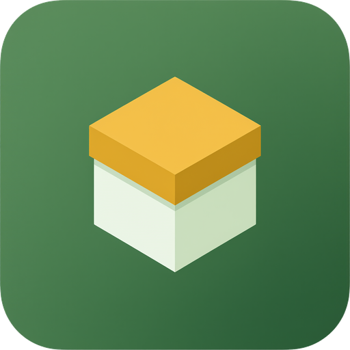

# Bobox

[](https://github.com/ofek150/Bobox/actions/workflows/ci.yml)



Bobox is a file sharing platform for uploading, organizing and collaborating on files and folders — a soft, friendly UI (light & dark), in-app previews, and a serverless backend.

**Live:** https://bobox.netlify.app

## Features

- **Upload files** of various sizes — direct-to-storage uploads via presigned URLs, with a drag-and-drop zone and progress
- **Organize in folders** — nested folders, a breadcrumb path bar, search and filters
- **Collaborate** — share files and folders by email with access levels; shared items appear in a dedicated Shared area
- **Public links** — generate expiring public download links for any file
- **In-app previews** — images, video, audio, PDF and text files open inside Bobox, no popups
- **Touch-first UX** — long-press (mobile) and right-click (desktop) open per-row action menus with haptic feedback; pages, lists and popups are fully animated (with `prefers-reduced-motion` support)

## Tech stack

**Client** — React 19, TypeScript, Vite 7, Tailwind CSS v4 + shadcn/ui (Radix primitives), React Router 6, Sonner toasts. The calm-sage design system lives in theme tokens (`Client/src/index.css`), so light/dark and palette changes are token-level.

**Backend** — Firebase: Auth, Firestore (metadata), Cloud Functions **v2 / 2nd gen** (Node 22, callables on Cloud Run with a 2M-invocation/month free tier). Cloudflare R2 object storage, accessed through the S3 API from the client via presigned URLs. Spend guardrails: project budget alerts at ₪1/month, Artifact Registry image cleanup (1 day), and a Firestore daily usage cap (set in the console, hard-stops past it).

**Deploy** — Netlify (builds from this repo via `netlify.toml`, auto-deploy on push to `main`) + Firebase Functions (deployed manually with `npm run deploy` from `Server/functions/`). GitHub Actions CI (`client-build`, `functions-build`) gates every PR and push to `main`.

## Repo layout

- `Client/` — the web app (pnpm)
- `Server/functions/` — Firebase Cloud Functions + Firestore rules (npm)

## Getting started

```bash
cd Client
pnpm install
pnpm dev        # http://localhost:3000
```

The client talks to the live Firebase project by default; `Client/.env.example` documents the env vars for pointing at emulators.

## Logo & design

The logo (sage box tile, amber lid) and its SVG design concepts live in `design/logo/`.

## License

MIT — see [LICENSE](LICENSE).
